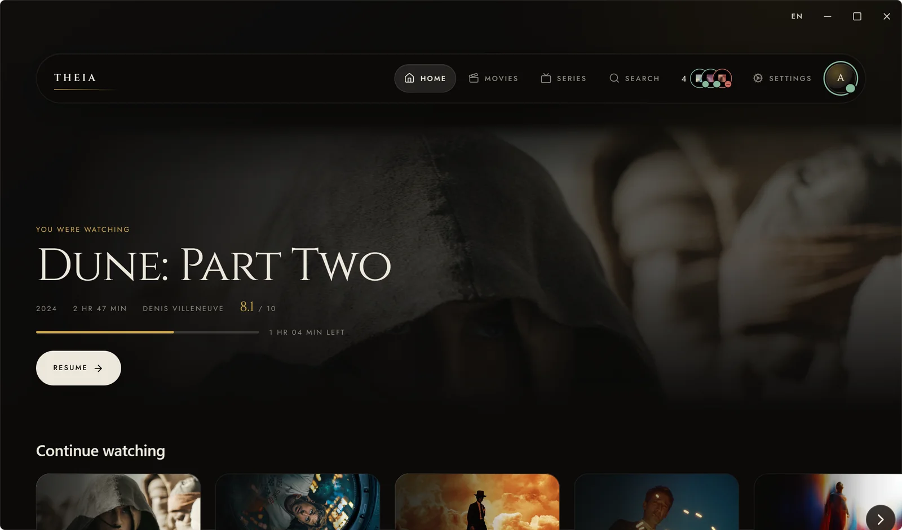
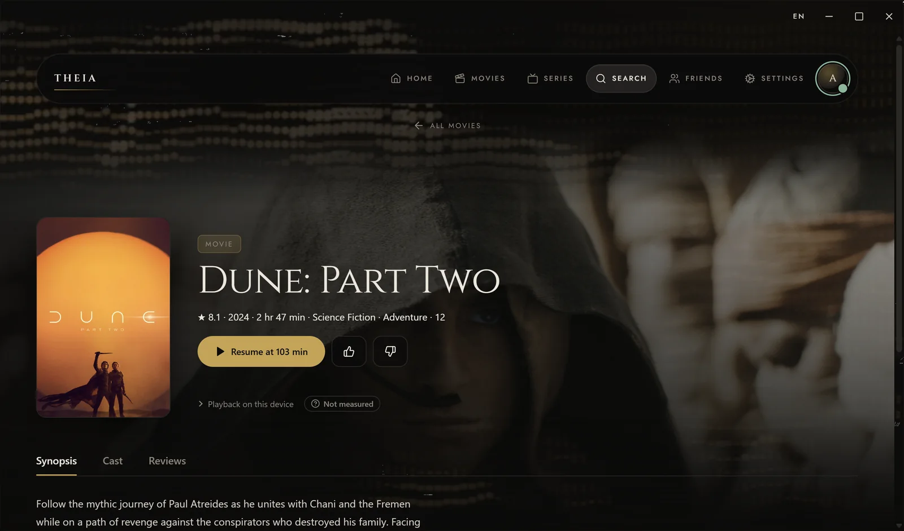
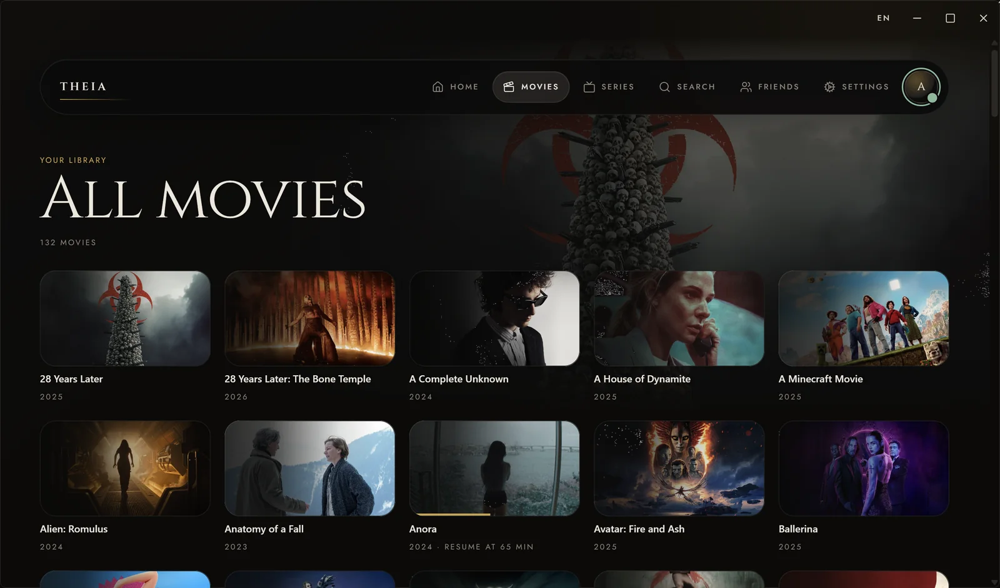
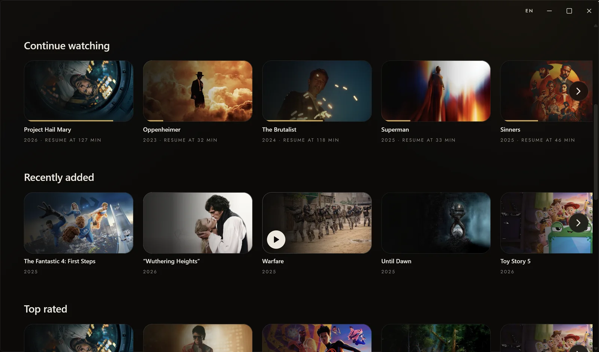
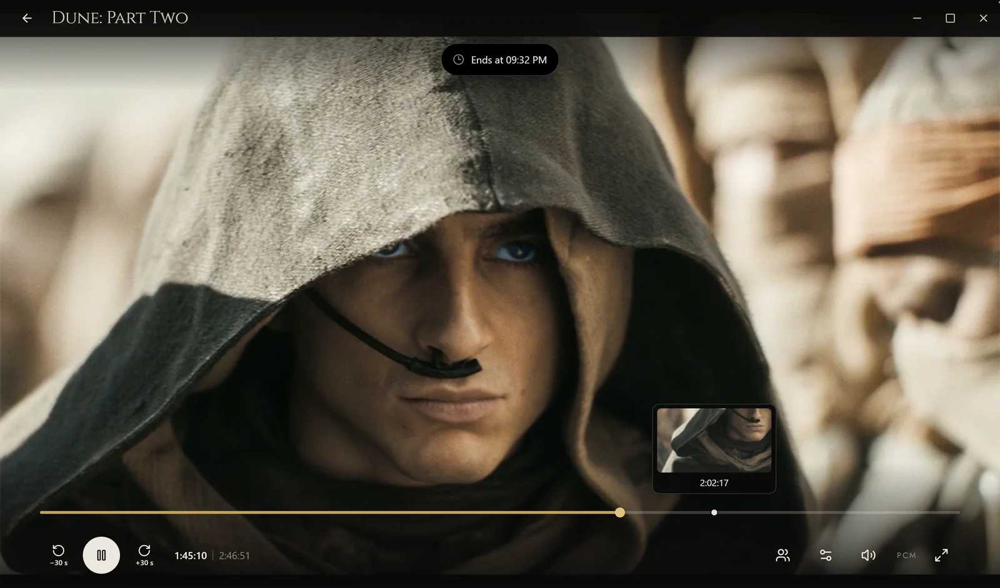
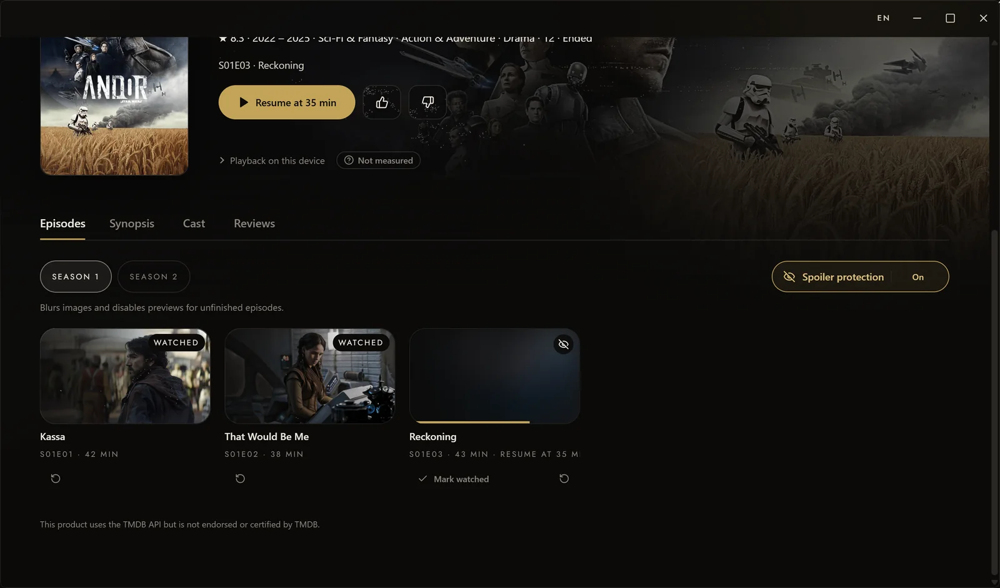
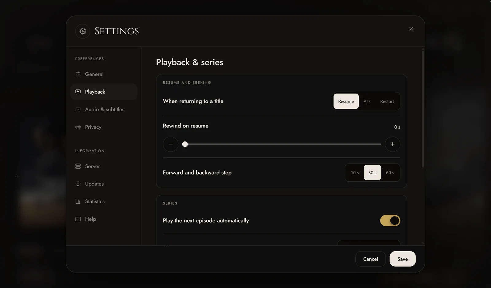
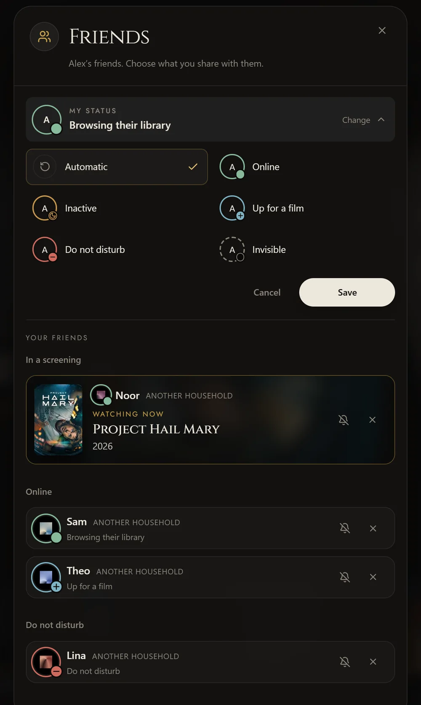

<p align="center">
  
</p>

<h1 align="center">Theia</h1>

<p align="center">
  <strong>Your films and series. Your friends. No account.</strong>
</p>

<p align="center">
  <a href="https://github.com/Benitoow/theia-media/releases/latest"></a>
  <a href="LICENSE"></a>
  
  
  
</p>

<p align="center">
  <a href="https://benitoow.github.io/theia-media/">Website</a> ·
  <a href="#downloads">Downloads</a> ·
  <a href="docs/releases/v4.4.3.md">4.4.3 release notes</a> ·
  <a href="#three-minute-setup">Setup</a> ·
  <a href="#theia-plex-jellyfin-or-emby">Compare</a> ·
  <a href="https://discord.gg/p4Rp4zHdHf">Discord</a>
</p>



*The home screen of the native player, in English, on a sample library of 132 recent films and 40 series with friends around. How these pictures were made, and what is real in them, is in [docs/screenshots](docs/screenshots/README.md).*

Theia turns folders of films and series into a private cinema. A small server
looks after your library, a native desktop player plays it, and your friends can
see who is around and watch with you. There is no cloud account, no telemetry, no
Docker stack and no external database to install.

<table>
  <tr>
    <td width="50%"></td>
    <td width="50%"></td>
  </tr>
</table>

*A film page and the library. The artwork, synopses and ratings are real TMDB metadata; the files behind them are two-second clips, so they are not films.*



*Further down the home screen: where you stopped, what was added, and the best rated.*

| One download | Built for choosing | Private by default |
| --- | --- | --- |
| One setup includes the server, launcher, native player and media engine. Choose all-in-one, server-only or player-only. FFmpeg is downloaded only when the server needs conversion. | Resume, profiles, watchlists, duration filters, one search across films and series, and a nightly pick. | No telemetry or cloud library. Metadata comes from TMDB; updates come from GitHub Releases. |

## Theia 4.4.3

> [!IMPORTANT]
> **Theia is free, and 4.4.3 is a repair at the end of the V4 line.** The
> server, the library, ordinary viewing and everything in this release cost
> nothing, and every change reaches everyone for free for a duration that is not
> decided. Which later features might become paid, if any, has not been decided
> either; it will be settled in the open and announced well before it happens.
> Nothing is paid today.

4.4.3 fixes the interface update path left behind by 4.4.2: an installation
updated from a tester build saw the server change version while the interface
stayed on the tester build. The update button now reads a tester build as older
than its release, and the signed interface pack carries the repair. A **product
update**: update from Theia's own button, no setup needed.
[Read the 4.4.3 release notes](docs/releases/v4.4.3.md).

4.4.2 improves the native player, so **an installation older than 4.4.2 runs the
4.4.3 setup once**: a server-only update does not replace the player. Your
library, profiles, watchlists and history stay in place.
[Read the 4.4.2 release notes](docs/releases/v4.4.2.md).

- **A timeline you can read.** A still of the exact scene follows the pointer along
  the playback bar, with its time, and nothing seeks until you click.
- **Episodes that follow on.** *Skip opening* on a click, a cancellable 30-second
  countdown to the next episode, a stop at the end of a season, and a sleep
  timer. The markers are the chapters named in the file; Theia does not guess.
- **Skip arrows that keep up:** 30 seconds by default, shown on the buttons, with
  a choice of 10, 30 or 60.
- **Settings in eight places,** including audio and subtitle choices remembered
  per series, ordered languages, an audio output, interface scale, cache sizes
  and editable shortcuts. Everything that was there is still there.
- **Player updates are your choice.** Nothing is checked on its own until you
  switch on *Automatic updates* or press *Check for updates*.
- **Presence you can read, and private rooms.** Friends are online, inactive,
  watching or offline; you can choose *Up for a film*, *Do not disturb* or
  *Invisible*. A watch-party room admits only the friends its host invites.
  Spoiler protection on a series page blurs the episodes you have not seen.



*The timeline preview: the pointer is at 2:02:17, nothing has seeked, and the scene
at that second is drawn above the bar. The picture is a stand-in made from the
film's own backdrop; see [docs/screenshots](docs/screenshots/README.md).*

<table>
  <tr>
    <td width="50%"></td>
    <td width="50%"></td>
  </tr>
</table>

*Spoiler protection on a series page, and the Playback settings.*

## Which program goes where

Theia is three programs, and which ones belong on a machine depends on the
house, not on taste.

| Your setup | What to install | Why |
| --- | --- | --- |
| One computer that holds the films and is plugged into the screen | **All-in-one**, the default answer in the installer | It serves and it plays. Nothing travels over the network, so nothing is limited by it. |
| A small machine in a cupboard or a NAS, and a television, a laptop or a desktop you watch on | **Server only** on that machine, then **player only** on each device you watch on | The server indexes, stores and streams; the player uses the sound and picture hardware of the machine in front of you, which is where the difference is heard. |
| A computer that only watches, with the films held elsewhere | **Player only** | No library is scanned or stored locally. It asks the server for the catalogue and the files. |
| A phone, tablet or television browser | **Nothing**; open the address the server prints in a browser | The web viewer remains available. Its viewing features are complete and no longer developed; server settings and administration are still maintained. |

The desktop downloads are **Windows x64**, **macOS** (Apple Silicon and Intel)
and **Ubuntu 24.04 x64**. The **ARM64** setups, Windows and Ubuntu, are deferred
until their native checks can run; until then those
computers keep 4.2.1, which stays downloadable and keeps working. Linux needs
X11 or XWayland and the two packages listed under [Downloads](#downloads).
Other Linux distributions are not verified.

## What you get

- **A library that stays current.** Theia scans several folders, watches for new
  files, groups alternate versions under one title and keeps files where they
  already live. Recognition reads French and streaming tags, editions, sequel
  numbers and many episode spellings.
- **Films and series with proper detail pages.** Artwork, synopsis, cast and
  available files, with TMDB metadata cached by the server. You can inspect
  resolution and HDR metadata before playing; device checks describe what the
  driver reports. Title pages have tabs, and a playback check measures the file
  and says whether it plays here, and why.
- **A cinema that remembers people.** Local profiles keep separate progress,
  watched state and watchlists, and ask at startup who is watching. Profiles are
  household identities, not accounts; they have no passwords.
- **Playback that remembers.** The player saves your server address, volume, mute
  state and window size. Audio and subtitle choices apply to films and episodes,
  and are remembered per series. Series show resume progress and offer the next
  episode, with optional autoplay and time to cancel.
- **A native player.** It reads Matroska and renders subtitles through libmpv.
  Sound and picture capabilities depend on the operating system and the actual
  device: Windows can use supported bitstream outputs, while macOS and Linux use
  PCM. Linux uses software decoding and SDR rendering.
- **A server that adapts.** Direct play, remux and transcoding serve different
  client capabilities. The server remains a separate Go binary with SQLite and no
  graphical dependency.
- **Friends and shared viewing.** See who is around and what they watch, write an
  opinion on a film or a series for your friends, and watch together in a private
  room. See [Friends and rooms](#friends-and-rooms).
- **Access outside the house without a Theia cloud.** The built-in remote mode
  uses device-keyed WireGuard and exposes viewer capabilities only. There is no
  relay, rendezvous server or control plane.
- **Updates with a way back.** Theia verifies release digests, waits for playback
  to stop, swaps the executable atomically and keeps the previous version for
  rollback. A signed interface pack updates the player's screens without
  replacing its window or media engine, starts as a trial and falls back if it
  fails to launch; the setup replaces the native player itself.
  `theia-setup --check-player` asks, `--update-player` verifies the published
  digest, runs the new player before replacing anything, and refuses while the
  player is open.

Theia deliberately has no live TV, DVR, music library, plugins or multi-user
permissions. Dedicated phone and TV apps have no announced date; those devices
use the web viewer for now.

## Three-minute setup

1. Download the setup for your computer from [Downloads](#downloads). On
   macOS/Linux, make it executable with `chmod +x <filename>`, then run it. The
   installer is one full-screen program: it starts in your language, suggests
   film folders from your drives, shows its plan before writing anything, and
   updates an existing installation in place instead of starting again.
2. The setup already contains the complete product and installs without
   fetching additional Theia components. Windows installs per user under
   `%LOCALAPPDATA%\Programs\Theia`, adds Start Menu/Desktop entries and
   registers **Settings → Apps** removal. macOS installs under
   `~/.local/lib/theia`, links the app into `~/Applications` and the command
   into `~/.local/bin`. Linux installs under `~/.local/lib/theia`; start the
   `theia` command there. Services remain opt-in and no elevation is required.
3. Start Theia from its entry, or let the installer start it for you. It offers
   an autostart entry (a launchd agent on macOS) and asks for no administrator
   rights. From a terminal, `theia` starts the server if it is not answering
   and then opens the player; `theia server` and `theia player` start one half
   alone, and `theia-server` / `theia-player` run them in the console.
4. Open **Settings**, add or confirm your media folders, then start the scan.

To remove it later, `theia-setup --uninstall` takes away the programs, the entries
and the autostart record, and **keeps your data**: the library, the progress marks
and the configuration stay in `%APPDATA%\Theia` on Windows,
`~/Library/Application Support/Theia` on macOS and `~/.config/theia` on Linux, and
the command says where they are. Custom data locations are kept too. On Windows,
`theia-setup --repair-registration` restores a missing **Settings → Apps** entry
without reinstalling.

## Friends and rooms

Each profile has a **friend code**. Open the friends sheet in the player, copy
your code to somebody, and enter theirs.

1. Entering a code sends a request. You are told at once which profile it
   reached, or that the person does not exist.
2. The other side sees the request and accepts or declines. Nobody pastes a code
   back.
3. Once you are friends, each of you sees the other's current film or episode as
   a card, for ninety seconds after it stops, unless they chose to hide it.

A friend can be another profile in your own house or somebody in another
household with their own server. Households meet through a small Firebase
database run for Theia: your server signs in anonymously, with no account and
nothing to type, and no port has to be open. A request waits there while your
friend is offline, and what you are watching reaches them within a second or two.
Codes read `THEIA2-XXXXX-XXXXX`; an older code still works.

<p align="center"></p>

*The friends sheet, with the six choices of your own status open. The friends are invented.*

**Presence.** The library bar shows how many friends are around, with their faces
beside the number. A friend is *online*, *inactive* (nobody has touched their
player for 2, 5 or 10 minutes, as they chose), *watching* or *offline*, drawn
with a mark on the photo that does not rely on colour alone. It follows an open
player, not a server that happens to be on, and pausing a film is never
announced. You can set yourself, for a while or until you change it, *Up for a
film*, *Do not disturb* or *Invisible*, hide the title you are watching or your
last-seen time, and ask for a quiet notice when a chosen friend returns. Ending a
friendship ends it on both sides, even if the other server was off at the time.

**Opinions.** A thumb and a few lines on a film or a series, seen by your
friends. There is one opinion per title; it appears as your own review, with Edit
and Delete, and reaches friends through the same database.

**Watch parties.** Open a room from the film you are watching. A room is private:
only the friends the host invites can join, each invitation is for one profile and
lasts until the room ends, and the host may also let others ask to join. Everyone
stays on the same second; each person plays their own file from their own server,
and a friend without the film can watch the host's copy. Audio and subtitles stay
personal. The room travels through Theia's built-in WireGuard tunnel, so hosting
or joining one needs remote access, which the friends sheet can turn on. Everyone
in a private room needs 4.4.2.

## Downloads

Every download below is a complete setup: the server, the launcher, the native
player and its media engine, for all-in-one, server-only or player-only. **The
setup looks for a newer setup before it installs**, so the file you downloaded,
kept or sent to a friend always installs the newest Theia; offline, it installs
what it carries.

| Platform | The download | |
| --- | --- | --- |
| Windows x64 | [Windows x64 setup](https://github.com/Benitoow/theia-media/releases/latest/download/theia-setup-windows-amd64.exe) | **supported** |
| macOS Apple Silicon | [Apple Silicon setup](https://github.com/Benitoow/theia-media/releases/latest/download/theia-setup-darwin-arm64) | **supported** |
| macOS Intel | [Intel Mac setup](https://github.com/Benitoow/theia-media/releases/latest/download/theia-setup-darwin-amd64) | **supported** |
| Ubuntu 24.04 x64 | [Linux x64 setup](https://github.com/Benitoow/theia-media/releases/latest/download/theia-setup-linux-amd64) | **supported** |
| Windows ARM64 | [Windows ARM64 setup](https://github.com/Benitoow/theia-media/releases/download/v4.2.1/theia-setup-windows-arm64.exe) (4.2.1) | 4.4 deferred; native checks pending |
| Ubuntu 24.04 ARM64 | [Linux ARM64 setup](https://github.com/Benitoow/theia-media/releases/download/v4.2.1/theia-setup-linux-arm64) (4.2.1) | 4.4 deferred; native checks pending |

Mac apps are ad-hoc signed and not notarised: open the app the first time with
Control-click → Open.

**Upgrading from 4.4.x:** 4.4.2 and 4.4.3 are product updates for a level-3
player: use Theia's own update button. An installation older than 4.4.2 runs the
4.4.3 setup once; it replaces the native player, which the new interface
requires, and keeps your data. **Upgrading from 3.x:** run the new setup. It reads
the installation, updates it in place, closes running programs and restarts the
server; your data stays. An automatic server update alone does not replace an
older player.

Ubuntu desktop prerequisites:

```sh
sudo apt install libwebkit2gtk-4.1-0 libayatana-appindicator3-1
```

Theia ships its pinned LGPL media engine and the libraries it loads, beside the
player in `TheiaPlayer/`, with the licence text of each. Ubuntu supplies its
desktop, driver and audio-server libraries. Linux uses software decoding and
rendering in SDR; hardware acceleration and HDR output are not available there
yet.

The six standalone `theia-server-<os>-<arch>[.exe]` files remain for existing
server updaters. Player, launcher and engine files are carried inside the public
setups; the internal payload ZIPs are not additional downloads.

Windows binaries are unsigned and may show a reputation warning. Mac apps
are ad-hoc signed and not notarised, so macOS may require first-launch approval
in Privacy & Security. The setup payload includes `START-HERE.txt` with platform
instructions.

> [!WARNING]
> The LAN service has no login. Anyone who can reach TCP `8383` can browse,
> stream and administer Theia. Keep it on a trusted network and **never forward
> port 8383 to the internet**. Use Theia's remote-access screen instead. The
> [security policy](.github/SECURITY.md) explains the boundary.

## Hardware guide

The expensive part is video conversion. Direct play mostly reads a file and
writes it to the network, so buying a server before checking what your clients
decode is an excellent way to purchase an idle CPU.

| | Minimum for direct play | Recommended when conversion is likely |
| --- | --- | --- |
| CPU | Any 64-bit `x86_64` processor or Apple chip; the ARM64 Windows and Ubuntu setups return in early November, see [Downloads](#downloads) | 4 recent CPU cores, or a supported hardware H.264 encoder |
| Free RAM | 512 MB | 2 GB |
| App disk, excluding media | 250 MB | 1 GB for a larger artwork cache and working room |
| Network | Faster than the media file's bitrate | Gigabit Ethernet for high-bitrate 4K remuxes |
| Viewer | A supported desktop app, or the phone/TV web viewer | A device whose tested decoding and output capabilities match your library |

The V3.2 Windows candidate measured **27.3 MB of resident memory** before a
100-cycle stream endurance run and **32.9 MB** at its observed end and peak. A
separate 10,000-film catalogue benchmark ended at **44.0 MB** of working set;
the workloads are not interchangeable. The binary is **17.7 MB** and the
installed FFmpeg runtime is about **87.9 MB**. Hardware encoders and decoders
are tested on the host before Theia chooses one. Software conversion still
needs enough CPU to remain above real time.

Windows x64 is the maintainer's real-device validation platform: it is where the
app has played his own library on hardware he owns. Release CI builds all six
x64/ARM64 targets. Desktop promotion additionally requires an installed-product
test and a captured moving test film with visible playback controls on a native
runner, which Linux x64 and ARM64 now pass with the bundled engine. Hosted
runners cannot establish hardware decoding performance, real audio endpoints,
HDR output or a first Gatekeeper launch on your own computer. Those still need
reports from real users, and the two supported platforms are where a report has
a release to land in.

For perspective, Plex currently recommends at least a Core i3 and typically 4 GB
RAM, while Jellyfin's current general recommendation is 8 GB and a modern media
engine for transcoding. Their workloads and feature sets are larger, so those
numbers are context rather than a benchmark against Theia. See the official
[Plex requirements](https://support.plex.tv/articles/200375666-plex-media-server-requirements/)
and [Jellyfin hardware guide](https://jellyfin.org/docs/general/administration/hardware-selection/).

## Theia, Plex, Jellyfin or Emby?

Choose the product whose compromises match your home. A wall of green ticks
would be advertising wearing a Markdown costume.

| | **Theia** | **Plex** | **Jellyfin** | **Emby** |
| --- | --- | --- | --- | --- |
| Best fit | One household that wants the smallest possible film-and-series server | The broadest polished client ecosystem | A full open-source, multi-user media platform | A configurable commercial media platform |
| Cost | Free (noncommercial licence from 4.0; GPL-3.0 up to 3.4); later optional extras are not decided | Local personal video is free; remote video and hardware transcoding use paid passes | Free, GPL-2.0, no premium tier | Free tier; several server and app features use Premiere |
| Identity | No account; passwordless local profiles, friends by code | Plex account model | Local users and permissions | Local users; optional Emby Connect |
| Server setup | One native binary for the server, no Docker or external runtime; the desktop player is a separate native application | Installers and NAS packages | Native packages, containers and NAS options | Installers, containers and many NAS options |
| Clients | A native desktop player, and a responsive browser for administration and server settings | Browser plus wide TV, mobile, desktop and console coverage | Browser plus official and community apps | Browser plus TV and mobile apps |
| Hardware transcoding | Included; host capabilities are probed | Plex Pass | Included | Generally Premiere, with documented device exceptions |
| Remote model | Embedded WireGuard, device keys, viewer-only routes | Account-based remote streaming; a paid pass is required for personal video away from home | You configure networking or a proxy | Manual access or Emby Connect |
| Live TV, music, plugins | No | Yes | Yes | Yes |

The competitor rows were checked against their official documentation in
September 2026: [Plex plans](https://www.plex.tv/plans/) and
[hardware transcoding](https://support.plex.tv/articles/115002178853-using-hardware-accelerated-streaming/),
[Jellyfin installation](https://jellyfin.org/docs/general/installation/) and
[source repository](https://github.com/jellyfin/jellyfin), and
[Emby installation](https://emby.media/support/articles/Installation.html) and
[Premiere feature matrix](https://emby.media/support/articles/Premiere-Feature-Matrix.html).
Those products change; follow the links before spending money or rebuilding a
server around one row.

## Privacy, data and limitations

Theia stores configuration, SQLite data and cached artwork under `%APPDATA%\Theia`
on Windows, `~/Library/Application Support/Theia` on macOS and `~/.config/theia`
on Linux. Media stays in the folders you selected.

The outbound services are TMDB for metadata, GitHub Releases for updates and,
for friends in other households, Theia's Firebase Realtime Database. Firebase
receives, under an anonymous server identity, directory entries for all local
profiles (their names, pictures, server public key, profile number and port),
even before a friend is added. Between linked friends it carries requests, your
current presence and the opinions you write. Presence is your chosen availability,
a generic activity (browsing, in a room, watching) and, unless you turn it off,
the last moment your player was seen; only that last moment is kept, never a
history. *Invisible* publishes no activity, title, room offer or last-seen time,
and hiding a title hides its artwork and episode details too. An opinion is stored
in the inbox of each friend who can read it until you delete it, end the
friendship, or they delete it, and ending a friendship leaves an authenticated
removal notice for the other side until their server has processed it. Your
library catalogue and viewing history are not uploaded. These choices belong to a
local profile and can be changed in the Privacy settings.

There is no telemetry endpoint, analytics SDK, cloud account or frontend CDN.
Remote access and watch parties use encrypted WireGuard traffic between your
servers. Discord Rich Presence, when you switch it on, speaks only to the Discord
client on your own computer.

The LAN site uses HTTP. The web viewer cannot draw image subtitle formats such as
PGS and VobSub without burning them into video; the native player renders them
directly through libmpv.

Opening and ending markers in the player come only from chapters named in the
file. They are not detected from picture or sound, and many files have none.

## Release history

Each release has its own notes, with what changed, what to do when updating and
what was and was not checked.

- **[4.4.3](docs/releases/v4.4.3.md)** — the interface follows the update: a
  tester build now ranks below its release, and the signed pack carries the
  repair so a level-3 player updates silently.
- **[4.4.2](docs/releases/v4.4.2.md)** — the V4 finale: the exact-frame
  timeline, episodes that follow on, eight settings categories, player updates
  as a choice, richer presence and private rooms. Run the setup once from older
  than 4.4.2.
- **[4.4.1](docs/releases/v4.4.1.md)** — one opinion per title, shown as your own
  review with Edit and Delete; opinions carried through Firebase; friends shown as
  online, inactive or offline.
- **[4.4.0](docs/releases/v4.4.0.md)** — the native player separated from its
  interface, so compatible updates are smaller; friend requests that wait in
  Firebase; progress and preference migration fixed.
- **[4.3](docs/releases/v4.3.0.md)** — opinions between friends; title pages with
  tabs and a playback check; a lighter player; macOS is back; an installer that
  looks for a newer installer first.
- **[4.2.2](docs/releases/v4.2.2.md), [4.2.1](docs/releases/v4.2.1.md),
  [4.2](docs/releases/v4.2.0.md)** — every quality in the menu; the Windows player
  shares the audio output, true fullscreen over the taskbar, complete updates; an
  island with faces and artwork, reliable fullscreen controls and room lifecycle
  fixes.
- **[4.1](docs/releases/v4.1.0.md)** — watch parties and the island, remote
  access in one press, closing the player closes the server it started.
- **[4.0](docs/releases/v4.0.0.md)** — *Who's watching?*, friends, Discord Rich
  Presence, a rebuilt installer, better file recognition and an LGPL media engine
  on Linux.
- **[3.4 and earlier](docs/releases/v3.4.0.md)** — the V3 generation, up to the
  native desktop apps.

**After 4.4.3.** The next step is **Theia 5.0**, which looks outward: cloud and
servers, and storage in the cloud, the things that surround Theia. Whether it also
opens Theia to mods or plugins is not decided, and there is no date. **There will be
no account and no telemetry**, and for now every feature of V4 stays free. Comments
and likes or dislikes on films remain a direction without a date; direct messages
and calls are out of scope.

## Help test and shape Theia

All desktop packages pass native installation and generated-film checks. Those
tests cannot cover every screen, audio device or household library, so real
reports matter — on **Windows x64**, **macOS** and **Ubuntu 24.04 x64**, and on
ARM64 once its setups return in early November. A try of **friends and a private
room between two households** is worth as much on any of them. Tell us what
worked as well as what failed.

- [Join the field test](https://github.com/Benitoow/theia-media/issues/new?template=field_test.yml)
  and read the short [testing guide](docs/field-testing.md).
- Talk to other users and testers on the [Discord server](https://discord.gg/p4Rp4zHdHf).
- A [GitHub star](https://github.com/Benitoow/theia-media) helps this small
  project reach more people. Thank you to everyone who already has.

## Source code

This repository holds Theia's releases, release notes, website and issue
tracker. From 4.0 the source code is developed privately and is not published
here. Theia is a single-maintainer project built with disclosed AI assistance;
every change is still reviewed and verified on the running product.

The source of 3.4.0 and every earlier release stays public at its tag
(`v3.4.0`, `v3.3.6`, …), under the GPL-3.0 those releases were published with.

## Licence and attribution

Theia 3.4.0 and earlier are free software under the [GNU General Public License v3.0](LICENSE-GPL-3.0).
Everything after 3.4.0, including 4.0, is distributed under the
[PolyForm Noncommercial License 1.0.0](LICENSE): you may use it and share it for
noncommercial purposes, and commercial use needs a separate licence.

This product uses the [TMDB API](https://www.themoviedb.org/) but is not endorsed
or certified by TMDB. FFmpeg is downloaded from its pinned upstream release and
remains under its own licence. The embedded Cinzel and Jost typefaces use the SIL
Open Font License 1.1.
